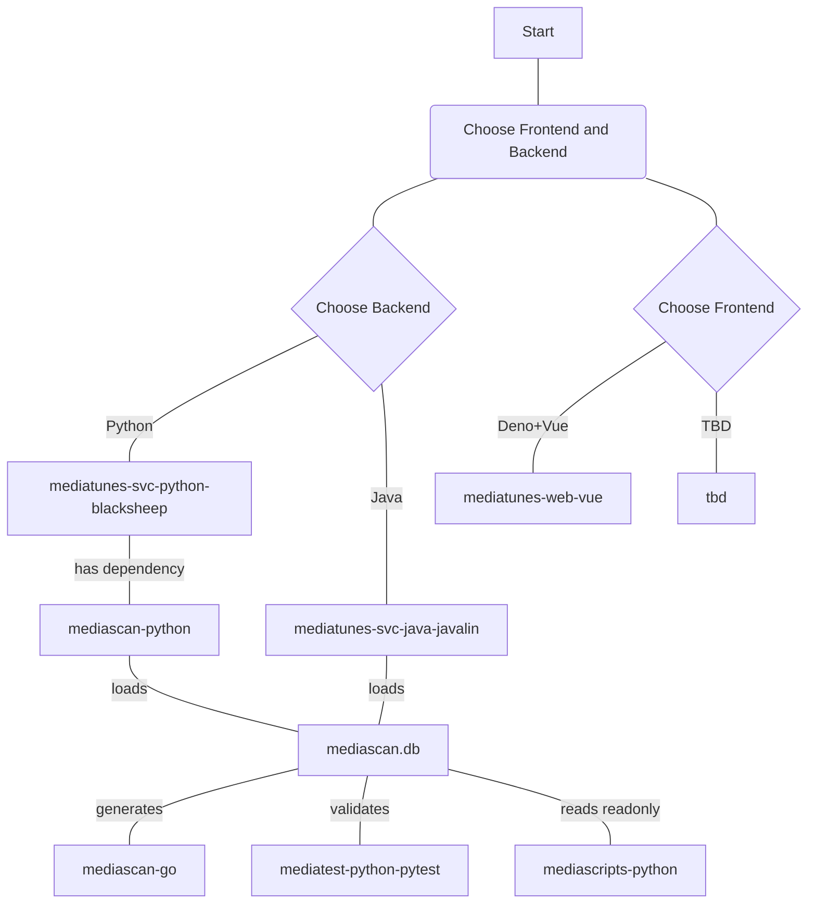

# moongas-mediascan-go

> 🚧 **Status: Work in Progress (WIP)**  
> This project is currently under active development. Features, APIs, and documentation are subject to change.

---

## Overview

**Simple and fast Golang command-line utility for scanning media library files and metadata files, extracting metadata (e.g. ID3v2 tags) and saving it into an SQLite database.**

### A component of the `moongas` ecosystem of media library tools

- [moongas-collection-demo](https://github.com/moongas-org/moongas-collection-demo) [](https://github.com/moongas-org/moongas-collection-demo/actions/workflows/ci.yml) - Example Moongas media collection (metadata only)
- [moongas-mediatunes-web-vue](https://github.com/moongas-org/moongas-mediatunes-web-vue) [](https://github.com/moongas-org/moongas-mediatunes-web-vue/actions/workflows/ci.yml) - A Deno-tooled TypeScript/Vue SPA for Moongas hybrid media collections, pairing with the separate moongas-mediatunes-svc-python-blacksheep backend to seemlessly blend offline and streaming playback
- [moongas-mediatunes-svc-python-blacksheep](https://github.com/moongas-org/moongas-mediatunes-svc-python-blacksheep) [](https://github.com/moongas-org/moongas-mediatunes-svc-python-blacksheep/actions/workflows/ci.yml) - Python+BlackSheep implementation of API service for Moongas hybrid media collections—backend for Moongas mediatunes web application (moongas-mediatunes-web-vue)
- [moongas-mediatunes-svc-java-javalin](https://github.com/moongas-org/moongas-mediatunes-svc-java-javalin) [](https://github.com/moongas-org/moongas-mediatunes-svc-java-javalin/actions/workflows/ci.yml) - Java+Javalin implementation of API service for Moongas hybrid media collections—backend for Moongas mediatunes web application (moongas-mediatunes-web-vue)
- [moongas-mediascan-go](https://github.com/moongas-org/moongas-mediascan-go) [](https://github.com/moongas-org/moongas-mediascan-go/actions/workflows/ci.yml) - Golang module to scan media collections and Moongas YAML metatadata, outputs Moongas database
- [moongas-mediascan-python](https://github.com/moongas-org/moongas-mediascan-python) [](https://github.com/moongas-org/moongas-mediascan-python/actions/workflows/ci.yml) - Python library with data classes for loading Moongas mediascan databases and YAML metadata files
- [moongas-mediascripts-python](https://github.com/moongas-org/moongas-mediascripts-python) [](https://github.com/moongas-org/moongas-mediascripts-python/actions/workflows/ci.yml) - Python scripts for working with Moongas media collections.
- [moongas-mediatest-python-pytest](https://github.com/moongas-org/moongas-mediatest-python-pytest) [](https://github.com/moongas-org/moongas-mediatest-python-pytest/actions/workflows/ci.yml) - Python tool for enforcing media collection rules (implemented with `pytest`)



## Features

- [`ScanTracks`](./internal/shared/scanner/track/track_scanner.go) returns
  `[]track.Track` from `root/artist/album/*.yml` in configured media directories.
  It excludes `artist.yml` and `album.yml`, honors `excludePaths`, and logs and
  skips access, read, and decode errors. Each result contains its full YAML-file
  path and parsed `TrackYamlFile`; no matching audio file or `album.yml` is required.

- [`ScanArtists`](./internal/shared/scanner/artist/artist_scanner.go) returns
  `[]artist.Artist`, containing each `ArtistYamlFile` and its directory
  path.

- [`ScanAlbums`](./internal/shared/scanner/album/album_scanner.go) walks configured
  media directories for `album.yml` files and returns `[]album.Album`,
  containing each `AlbumYamlFile` and its directory path.
  It honors case-insensitive `excludePaths`; access, read, and YAML parse errors
  are logged and skipped. It does not infer albums from media files.

- Suports reading metadata Moongas metadata file formats such as `artist.yml` and `album.yml` files
- Output format (SQLite database) is compatible with the Moongas `mediascan` python package

## Database Schema

The output database contains five tables:

| Table | Contents |
| ----- | -------- |
| mediafile | Track metadata from individual media files (ID3 tag information read from `mp3` files) |
| track | Core metadata from track YAML files discovered by `ScanTracks`, linked by `artistid` and `albumid` |
| trackstreaming | Streaming service identifiers for tracks, correlated by `trackid` |
| artist | Metadata from `artist.yml` files |
| album | Metadata from `album.yml` files, linked to artists by `artistid` |

Album metadata comes from `album.yml` in the album directory: `albumData.name`,
`albumData.dateReleased.y`, and `albumData.explicitCover`. Album YAML also supports
an optional `albumData.genres` list of strings. The album table's `genre` column
stores the first genre, or an empty string when the list is absent or empty. `ScanAlbums` supplies
these rows; directories without `album.yml` do not produce album rows.

The `track` table contains `id`, `path`, `albumpath`, `artistpath`, `title`,
`artist`, `albumartist`, `album`, `genre`, `year`, `artistid`, and `albumid`. Its unique `path` is the
track YAML-file path; album and artist paths are its parent and grandparent
directories. Metadata comes from `trackData`, without requiring a local audio
file. Artist and album path indexes use table-specific names.

`ScanTracks` runs once. Its results populate `track` first, then
`trackstreaming`, with one row per `trackIdData.streamingData` entry.
The columns are `trackid` (the corresponding `track.id`, resolved by YAML-file
path), `streamingservice`, and `streamingtrackid`. The table population uses
only the service and streaming track ID, not the URL or API response.
Tracks without streaming entries produce no `trackstreaming` rows.

Scanning and insertion run in order: artist, album, track, trackstreaming,
media files. Album and artist IDs are resolved by directory path, not metadata
names or scan positions. `mediafile` also contains `artistid`, `albumid`, and
`trackid`. Media files are still scanned with `ScanFiles`; their track IDs are
matched through `TrackYamlFile.mediaFileData` paths. Relative paths in that list
are resolved against the containing track YAML directory; absolute paths are
used directly. Multiple media files may reference the same track.
Missing relationships are stored as `NULL` with a warning. Pathless entries
(such as fingerprint-only metadata) cannot establish a media-file relationship.
If two tracks claim the same media-file path, database generation fails explicitly.

## Usage

### Scan to Database

The database command's entry point is [`main.go`](./cmd/scan-to-db/main.go).
Table creation, insertion, and display operations are grouped by table in
[`table_mediafile.go`](./cmd/scan-to-db/table_mediafile.go),
[`table_artist.go`](./cmd/scan-to-db/table_artist.go),
[`table_album.go`](./cmd/scan-to-db/table_album.go),
[`table_track.go`](./cmd/scan-to-db/table_track.go), and
[`table_trackstreaming.go`](./cmd/scan-to-db/table_trackstreaming.go), with matching per-table
test files.

- [`cmd/scan-to-db`](./cmd/scan-to-db) - Scans media libraries for mediafiles, moongas `artist.yml` and `album.yml` files, and track YAML files; outputs an SQLite database (`.db`) file
```bash
go run cmd/scan-to-db mediascan-config.yml mediascan.db
```

### Generate Album YAML

- [`cmd/scan-to-album-yaml`](./cmd/scan-to-album-yaml) - Creates an `album.yml`
  in each unique album directory found by the media-file scan. Existing files
  are always preserved; overwrite flags are not supported.
- Uses the first media file in scan order for `albumData.name` (album tag) and
  `albumData.dateReleased.y` (year tag). Sets `albumData.explicitCover` to
  `false` and omits release month and day.
- Populates `albumData.genres` with unique, non-empty genre values from every
  media file in the album, preserving first-seen order. Values are compared
  exactly; the field is omitted when no genres are available.

```bash
go run ./cmd/scan-to-album-yaml mediascan-config.yml [media-root]
```

### Update Track Fingerprints

Track YAML stores streaming identifiers and API responses in a `streamingData`
list inside the optional `trackIdData` object, replacing the former flat `isrc`,
`spotifyId`, `spotifyUri`, `spotifyUrl`, and other service-specific ID/URL fields:

```yaml
trackIdData:
  streamingData:
    - streamingService: spotify
      isrc: USSM10027739
      trackId: 0ZYf6N5eBeXStMri0mf3DZ
      trackUrl: https://open.spotify.com/track/0ZYf6N5eBeXStMri0mf3DZ
      apiData:
        tracks:
          items: []
mediaFileData:
  - fpcalcData:
      duration: 263.62
      fingerprint: example-fingerprint
    acoustidData:
      results:
        - id: example-acoustid-result
          recordings:
            - id: example-musicbrainz-recording
              title: Example Song
              length: 263620
              video: false
              firstReleaseDate: "1985-06-01"
              isrcs: [USSM10027739]
          score: 0.98
      status: ok
```

Each list item uses `StreamingData[any]`; API responses loaded from YAML or JSON
are generic maps rather than service-specific structs. Empty lists are omitted.
`streamingService` identifies the provider using the same names as the Python
project (for example `spotify`, `apple-music`, and `youtube-music`); custom
service names are also supported.
Existing flat fields are not automatically migrated.

`trackIdData` is a single object, not a list, and contains only streaming data.
It may be omitted or null; the previous list form is no longer accepted.
Fingerprints and AcoustID results
belong to the top-level `mediaFileData` list, matching the Python project.
Each entry uses the shared `MediaFileData`: metadata fields are optional pointers,
so fingerprint-only entries are supported. Duration is a floating-point value.
The scanner retains media-file paths and modification timestamps and populates
metadata pointers, including explicit zero values when tags are unavailable.
Album and artist directories are derived from the media-file path's parent and
grandparent directories rather than stored in `MediaFileData`.
YAML `modTime` accepts standard timestamps and Python's space-separated datetime
format with a timezone offset (for example, `2024-09-16 00:34:15.638511+00:00`).
Invalid timestamps are reported as decode errors and cause the track scanner to
skip the YAML file, so its media-file paths cannot establish track relationships.
AcoustID recording
metadata supports optional title, length (milliseconds), video, disambiguation,
first release date, and ISRCs. Legacy fingerprints under `trackIdData` are not
automatically migrated.

Track YAML/JSON decoding requires the same mandatory fields as Python:
`trackData` and all six core metadata fields; `streamingService`, `trackUrl`,
`trackId`, and `apiData` on streaming entries; `results` and `status` on AcoustID
responses; `id`, `recordings`, and `score` on AcoustID results; and `id` on
recordings. Missing fields return errors. Explicit zero values remain valid,
and optional fields may be omitted.

- [`cmd/fpcalc-to-track-yaml`](./cmd/fpcalc-to-track-yaml) runs `fpcalc --json`
  for media files that have an existing matching track `.yml` file but lack
  fpcalc duration or fingerprint data. It only updates the
  `mediaFileData[].fpcalcData` fields
  and creates a `.yml.bak` backup before modifying a track YAML file.
- Requires `fpcalc` to be installed and available on `PATH`.
- Accepts the same overwrite flags as the other scan commands:
  `--overwrite-existing` and `--overwrite-newer`.

```bash
go run ./cmd/fpcalc-to-track-yaml mediascan-config.yml [media-root]
```

## mediascan YAML Configuration file Reference

The  YAML configuration file (example: [mediascan-config.yml](./mediascan-config.yml)) supports the following parameters:

| Property | Description |
| -------- | ----------- |
| `mediadir` | the path to the directory to be scanned |
| `mediaexts` | the file extensions to be included in the scan |
| `excludepath` | path substrings to exclude from scan (case-insensitive) |
| `excludetitle` | id3 title substrings to exclude from scan results (case-insensitive) |
| `excludetitle` | id3 artist substrings to exclude from scan results (case-insensitive) |
| `excludealbum` | id3 album substrings to exclude from scan results (case-insensitive) |
| `excludegenre` | id3 genre substrings to exclude from scan results (case-insensitive) |
| `sortby` | (`year`, `artist`, `none`) media file sort options |
| `getmp3duration` | (`true`, `false`) whether to calculate mp3 duration using `tcolgate/mp3` (**warning: slow*) |

## Problem: `package moongas-mediascan-go/cmd/scan-to-db is not in std (/usr/lib/go-1.26/src/moongas-mediascan-go/cmd/scan-to-db)`

Solution:

```bash
cd moongas-mediascan-go
go build ./cmd/scan-to-db
```

### Dependencies
- [gopkg.in/yaml.v3](https://pkg.go.dev/gopkg.in/yaml.v3) (Used for reading and writing configuration and metadata YAML)
- [dhowden/tag](https://github.com/dhowden/tag) (Used for reading ID3 tags)
    - `dhowden/tag` is a nice little Go library for ID3, MP4 and OGG/FLAC metadata parsing. I added support for [genre codes in the 148-191 range](https://en.wikipedia.org/wiki/List_of_ID3v1_genres#Extension_by_Winamp) and David was kind enough to merge my [PR](https://github.com/dhowden/tag/pull/103).
- [tcolgate/mp3](https://github.com/tcolgate/mp3) (Used for calculating MP3 duration)
    - Note: Mp3 duration calculation can be disabed by setting `getmp3duration: false` in `mediascan-config.yml`. 
    - It's currently disabled because this library is suddenly unexpectedly slow for me.


## Performance Demo 1.5 - desktop PC with decade old i7 CPU
Much slower on first run. Why?

First run

```bash
2022/12/14 06:55:32 Successfully loaded 9124 media files
2022/12/14 06:55:32 Skipped 179 excluded media files

real	3m6.427s
user	0m4.687s
sys	0m5.567s

Second run

```bash
2022/12/14 07:09:53 Successfully loaded 9124 media files
2022/12/14 07:09:53 Skipped 179 excluded media files

real	0m3.637s
user	0m2.410s
sys	0m1.299s

```

## Installing Dependencies

> 🚧 **IIVO Warning: Information Is Very Outdated**  
> The information below is outdated and retained for development purposes only.

Install Go programming language compiler, linker, compiled stdlib and supplementary Go tools
```bash
sudo apt update
sudo apt upgrade
sudo apt install golang-go golang-src golang-doc golang-golang-x-tools
```

Edit `~/.bashrc` by adding the following lines:

```bash
export GOPATH=~/go
export GOROOT=/usr/local/go
export PATH=$PATH:$GOPATH/bin
export PATH=$PATH:$GOROOT/bin
```
Then reload it: `source ~/.bashrc`

Note: `GOROOT` directory may vary. To confirm, check the `go` symlink, e.g.:
```bash
$ which go
/usr/bin/go
$ ls -l /usr/bin/go
lrwxrwxrwx 1 root root 21 Sep 16  2020 /usr/bin/go -> ../lib/go-1.15/bin/go
```
So based on the above output on the rpi we need: `export GOROOT=/usr/lib/go-1.15`

To test it (Raspberry Pi):
```bash
$ $GOROOT/bin/go version
go version go1.15.15 linux/arm64
```

To test it (Linux desktop):
```bash
$ $GOROOT/bin/go version
go version go1.18.1 linux/amd64
```

Install Go dependency 1 of 2: `tag`
```bash
go get github.com/dhowden/tag/cmd/tag
```

Install Go dependency 2 of 2: `yaml.v3`
```bash
go get gopkg.in/yaml.v3
```

Now we can see that these packages were installed into `$GOPATH/src`:
```bash
$ ls $GOPATH/src
github.com  gopkg.in
```

Now install mediascan:
```bash
go get github.com/moongas-org/moongas-mediascan-go
cd ~/go/src/github.com/moongas-org/moongas-mediascan-go/ && go install
```

Edit [mediascan-config.yml](mediascan-config.yml) and set the `mediadir` to the desired directory path.

Now you should be all set to run mediascan.

You can run the database scanner from the repository directory like this:
```bash
go run ./cmd/scan-to-db mediascan-config.yml mediascan.db
```

Happy scanning!
